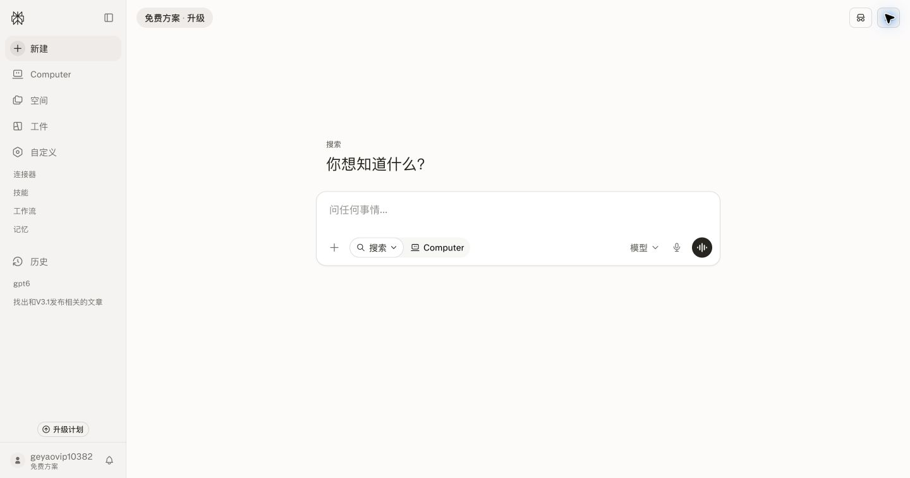
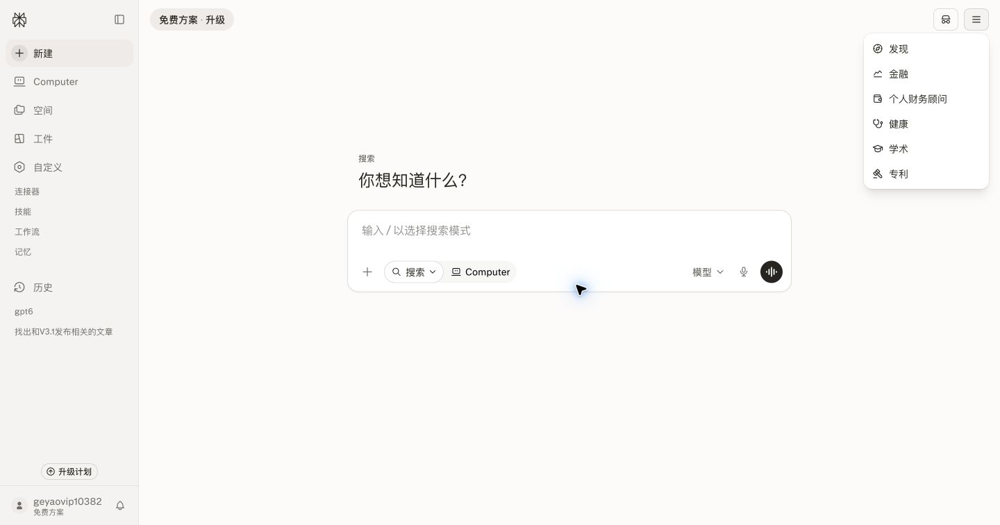
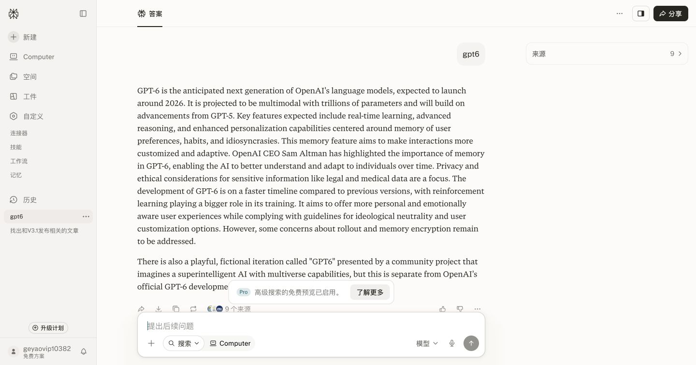

# Authenticated Perplexity UI Audit

Audit date: 2026-07-24  
Viewport: 1440×756  
Scope: authenticated desktop home, mode menu, and answer page  
Purpose: calibrate Auction Motion Studio editor rules, not clone Perplexity

## Audit routes

| Need | Read only |
| --- | --- |
| base workspace proportions and color | Step 1 |
| progressive disclosure and menus | Step 2 |
| buttons, typography, sticky controls | Step 3 |
| accessibility certainty | Accessibility evidence limits |

## Step 1 — Home workspace

Health: strong.

Observed:

- 200px navigation rail with approximately 3.5% warm brown-black tint
- content canvas is nearly white rather than strongly ivory
- a single central composer is the dominant action
- sparse 14px utility text, 16px input text, and generous empty space
- navigation selection is a soft neutral fill

Adoption:

- keep the content-first hierarchy and restrained surface separation
- use wider Auction Motion Studio domain panels because artwork thumbnails and catalog controls need more room

## Step 2 — Expanded mode menu

Health: strong, with clear progressive disclosure.

Observed:

- secondary modes stay out of the primary composer until requested
- floating menu uses a quiet border, modest shadow, and compact rows
- icon and label are paired; color is not needed to establish hierarchy

Adoption:

- place infrequent editor actions in contextual menus
- keep Generate/Export and quality status visible rather than hiding core workflow actions

## Step 3 — Answer page

Health: strong hierarchy; some lower controls are visually dense near the sticky composer.

Observed:

- 56px top command region and near-black filled Share action
- standard utility controls use 8px radius; chips use full pill radius
- answer content uses a 720px reading column and serif typography
- sticky composer floats over content with a light shadow
- dense actions, notice, source avatars, and composer compete near the bottom

Adoption:

- use near-black for the current primary editor action
- reserve pills for filters/modes/status
- keep floating elevation for transient or sticky controls only
- do not copy serif answer typography into interactive editor surfaces
- prevent the editor timeline, notices, and transport controls from stacking into one visually crowded band

## Accessibility evidence limits

Screenshots and computed styles support visual hierarchy, size, contrast direction, and spacing observations. They do not prove keyboard order, screen-reader names, hover behavior, reduced-motion handling, or dark-mode contrast. Those remain implementation-time tests.
